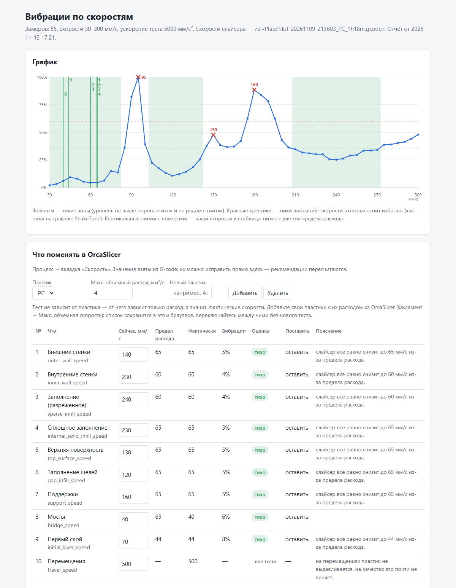

# klipper-vibr-report — на каких скоростях принтер «звенит»

Одна команда в консоли Klipper — `VIBR_TEST` — гоняет голову по квадрату на скоростях от 30 до 300 мм/с, записывает вибрации акселерометром и строит отчёт: график «скорость → вибрации», пики, тихие зоны и **таблицу по скоростям вашего профиля OrcaSlicer — что сейчас, тихо или резонанс, что поставить**. Отчёт — одна HTML-страница, скачивается из Fluidd/Mainsail и открывается в любом браузере без интернета.

- Сделано и проверено на **QIDI Q1 Pro со стоковой прошивкой** (Klipper QIDI на Python 2.7). Работает и на обычном Klipper.
- **ShakeTune не нужен** и не мешает: свои имена макросов и файлов. Движения головы — как у `VIBRATIONS_CALIBRATION` из ShakeTune 2.6.1.
- `printer.cfg` установщик не меняет: одну строку `[include vibr_test.cfg]` вы добавляете сами.



## Установка на стоковый QIDI Q1 Pro (одна команда)

По SSH (пользователь `mks`):

```bash
curl -fsSL https://raw.githubusercontent.com/GNUGiminot/klipper-vibr-report/main/install.sh | bash
```

Установщик проверит, что есть акселерометр, расширение `gcode_shell_command` и Python с numpy, скачает файлы в `~/klipper-vibr-report` и положит ссылку `vibr_test.cfg` в папку конфигурации. Потом один раз руками:

1. Fluidd/Mainsail → конфигурация → `printer.cfg` → рядом с другими `[include …]` добавить строку
   ```
   [include vibr_test.cfg]
   ```
2. «Сохранить и перезапустить».

## Запуск

Стол пустой, принтер не печатает. В консоли Fluidd/Mainsail:

```
VIBR_TEST
```

Оси захоумятся сами. Тест занимает 4–5 минут.

Та же команда со всеми параметрами — скопируйте и меняйте нужные значения:

```
VIBR_TEST PASSES=1 MIN_SPEED=30 MAX_SPEED=300 SPEED_INCREMENT=5 ACCEL=5000 SIZE=80 Z_HEIGHT=20 TRAVEL_SPEED=300 CLEAN=0
```

Что они значат (все необязательные, не указанные берутся по умолчанию):

| Параметр | По умолчанию | Что это |
|---|---|---|
| `PASSES` | 1 | сколько раз пройти весь диапазон в одном тесте (проходы усредняются; на проверочном принтере проходы подряд совпадали в пределах 2 %) |
| `MIN_SPEED` / `MAX_SPEED` | 30 / 300 | диапазон скоростей, мм/с |
| `SPEED_INCREMENT` | 5 | шаг, мм/с (3 — точнее, но дольше) |
| `ACCEL` | 5000 | ускорение на ходах теста (не выше `max_accel` принтера) |
| `SIZE` | 80 | сторона квадрата, мм |
| `Z_HEIGHT` | 20 | высота головы, мм |
| `TRAVEL_SPEED` | 300 | холостые перемещения, мм/с |
| `CLEAN` | 0 | `1` — «чистая» проверка: этот тест начинает новую серию, прежние тесты в `VIBR_COMPARE` не попадают. Ставьте после того, как подтянули ремни, что-то закрепили или поменяли |
| `CHIP` | — | имя акселерометра, если их несколько |

Примеры: `VIBR_TEST MAX_SPEED=250 SPEED_INCREMENT=3`; после регулировки механики — `VIBR_TEST CLEAN=1`.

Если при заданных `SIZE` и `ACCEL` голова на максимальной скорости идёт с постоянной скоростью меньше 70 % стороны квадрата, макрос предупредит в консоли: тогда поднимите `ACCEL` или `SIZE` (так же советует ShakeTune).

## Результат

Папка конфигурации → `vibr_report_results/` (хранятся 6 последних тестов с замерами и отдельно 6 последних отчётов сравнения):

| Файл | Что внутри |
|---|---|
| `vibr_report_<дата>.html` | график, пики, тихие зоны, таблица «что поменять в OrcaSlicer», все замеры |
| `vibr_recommendations_<дата>.csv` | ваши скорости, предел расхода, уровень вибраций, оценка, что поставить |
| `vibr_summary_<дата>.csv` | по каждой скорости теста: уровень, оценка, пик, оси X/Y/Z, главная частота |
| `vibr_data_<дата>.tar.gz` | сами замеры — для пересборки отчёта |

CSV — с разделителем `;` и десятичной запятой (русский Excel открывает двойным щелчком).

**Пластик.** Тест от пластика не зависит — голова ходит без подачи. От пластика зависит только максимальный объёмный расход, а значит, с какой скоростью слайсер реально напечатает линию. Скорости и расход отчёт берёт из самого свежего G-code. В отчёте есть список пластиков: добавьте свои (например, PC 4, ABS 17 мм³/с) — он сохранится в браузере, и переключение пересчитывает таблицу без нового теста.

**Как читать.** Уровень — энергия вибраций в процентах от самой «шумной» скорости теста. Это сравнение скоростей между собой, а не абсолютная величина. Оценку дают два порога (меняются в отчёте):

- **Нижний порог — «тихо» (по умолчанию 35 %).** Скорость тихая, если её уровень не выше порога и рядом (±1 шаг теста) нет пика. Чем меньше порог, тем строже отбор тихих скоростей.
- **Верхний порог — «резонанс» (по умолчанию 60 %).** Выше него вибрации сильные — на стенках жди ряби. Между порогами — «повышенные»: печатать можно, но лучше сдвинуть.
- **Пик** (красный крестик) — местный бугор кривой, как пики у ShakeTune. Скорость на пике считается резонансом при любой высоте, соседние шаги — «повышенными».

«Фактически» — скорость с учётом предела расхода. «Поставить» — ближайшая тихая скорость не выше предела расхода, с запасом от края резонанса.

## Сравнение тестов и «чистая» серия

На проверочном принтере два прохода подряд совпадали в пределах 2 %, а тесты в разные дни — нет: пик 95 мм/с был 39 %, 100 % и 40 % от максимума, хотя места пиков (75, 90–95, 150, 180–185 мм/с) не менялись. Поэтому полезнее сравнивать тесты из разных сеансов, чем гонять проходы подряд:

```
VIBR_COMPARE RUNS=3
```

Голова не двигается: макрос собирает один отчёт из последних `RUNS` тестов (по умолчанию 3) текущей серии. Каждый тест приводится к своему максимуму, уровни усредняются, пики и рекомендации считаются по среднему. На графике отдельные тесты — серые пунктиры с датами. Сильное расхождение — признак того, что механика меняется от раза к разу (температура, натяжение, что-то болтается).

Серия — это тесты после последнего `VIBR_TEST CLEAN=1`. Подтянули ремни или закрепили провод — запустите тест с `CLEAN=1`: старые замеры останутся в архиве, но в сравнение больше не попадут.

## Установка вручную (не сток, другой Klipper — с нуля)

Нужно:

- **Акселерометр** в конфиге (`[adxl345]` или другой) и рабочий: `ACCELEROMETER_QUERY` в консоли отвечает без ошибки.
- **Расширение `gcode_shell_command`** — файл `~/klipper/klippy/extras/gcode_shell_command.py`. На стоковом QIDI есть; на обычном Klipper ставится через KIAUH → Advanced → G-Code Shell Command.
- **Python с numpy.** На стоковом QIDI есть системный `python3` с numpy. На обычном Klipper numpy ставят в окружение Klipper для калибровки шейперов: `~/klippy-env/bin/pip install numpy`.

Затем:

```bash
cd ~
git clone https://github.com/GNUGiminot/klipper-vibr-report.git
chmod +x ~/klipper-vibr-report/*.sh
ln -s ~/klipper-vibr-report/vibr_test.cfg ~/printer_data/config/vibr_test.cfg   # на стоковом QIDI: ~/klipper_config/
```

В `printer.cfg` — `[include vibr_test.cfg]`, сохранить и перезапустить. Если клонировали не в `~/klipper-vibr-report`, поправьте путь в строке `command:` в `vibr_test.cfg`.

Вместо этих команд можно запустить `bash ~/klipper-vibr-report/install.sh` — он делает то же самое и проверяет требования.

## Если у вас уже стоит ShakeTune 2.x

Конфликтов нет: другие имена макросов (`VIBR_TEST`, `_VIBR_RUN`), команды (`vibr_report`) и файлов замеров (`*-vibr_sp*.csv`). Файлы ShakeTune не трогаются.

Отчёт можно построить и из замеров ShakeTune. На стоковом QIDI Q1 Pro его `VIBRATIONS_CALIBRATION` нужно запускать так (датчик в Klipper QIDI называется `default`, а без хоминга макрос не стартует):

```
G28
VIBRATIONS_CALIBRATION DIRECTION=XY MAX_SPEED=300 SPEED_INCREMENT=5 ACCEL_CHIP=default
```

Картинку ShakeTune он не построит («No CSV files found»: файлы сохранены как `adxl345-sp*.csv`, а ищутся `default-sp*.csv`) — постройте её вручную и сразу отчёт из тех же замеров (по SSH):

```bash
~/klipper-vibr-report/vibr_report.sh --input /tmp
~/klipper_config/K-ShakeTune/scripts/shaketune.sh --type vibrations --axis_name XY --accel 5000 --chip_name adxl345 --keep_csv
```

Отчёт — первым: ShakeTune после картинки упаковывает CSV в архив и удаляет их из `/tmp`. Из архива отчёт тоже собирается: `--input ~/klipper_config/K-ShakeTune_results/vibrations/vibrations_<дата>_XY.tar.gz`.

Подойдёт только ShakeTune 2.x (с файлами CSV). ShakeTune 3.x и новее хранит замеры в другом формате.

## Параметры скрипта отчёта

`~/klipper-vibr-report/vibr_report.sh [параметры]` — по SSH; без параметров берёт свежие замеры `VIBR_TEST` из `/tmp`, а если их нет — последний архив.

| Параметр | Что |
|---|---|
| `--input <папка/CSV/архив>` | замеры не из `/tmp` (в том числе ShakeTune) |
| `--gcode <файл или папка>` | скорости из конкретного G-code |
| `--maxvol 12` | макс. объёмный расход вместо значения из G-code |
| `--quiet 35 --peak 60` | пороги «тихо» и «резонанс», % от максимума |
| `--out <папка>` | куда сохранить отчёт |

## Обновление и удаление

- Обновить: снова запустить команду установки (или `bash ~/klipper-vibr-report/install.sh`) и перезапустить Klipper.
- Обновления из Fluidd/Mainsail: добавить в `moonraker.conf` секцию из `moonraker_update.conf`.
- Удалить: убрать `[include vibr_test.cfg]` из `printer.cfg`, сохранить, затем `bash ~/klipper-vibr-report/uninstall.sh`. Результаты остаются.

## Особенности стокового QIDI Q1 Pro (учтены)

- Klipper QIDI работает на Python 2.7 и принимает вывод скриптов только латиницей — поэтому сообщения в консоли на английском, а отчёт на русском.
- Нет `MINIMUM_CRUISE_RATIO` — макрос сам использует `ACCEL_TO_DECEL`.
- Хоминг QIDI (`homing_override`) ставит `M204 S10000`; после теста восстанавливаются значения, которые были после хоминга.

## Проверено

QIDI Q1 Pro, прошивка 4.4.20, 13–14.11.2026: установка с GitHub, `VIBR_TEST` в один (4,5 мин) и два прохода (9 мин), отчёт из консоли Klipper, сравнение тестов; отчёт из замеров ShakeTune 2.6.1.

Не проверено: **прошивка QIDI v6.1.1** (на ней может быть другой Klipper, папки и Python), обычный Klipper, G-code из QIDI Studio / Bambu Studio (ключи скоростей у них, скорее всего, те же, что в OrcaSlicer). Если запустите — напишите, что вышло.

## Ограничения: что тест не видит

- **Только направления X и Y.** Голова ходит по квадрату вдоль осей. На CoreXY диагональные ходы (45°) крутит один мотор, и резонансы там могут быть на других скоростях — а заполнение часто идёт как раз под 45°. Новый ShakeTune (`CREATE_VIBRATIONS_PROFILE`) для этого гоняет голову во многих направлениях и строит полярный график. Здесь диагоналей пока нет.
- **Разгон и торможение в замере.** Энергия считается по всему ходу, включая разгон. При `SIZE=80`, `ACCEL=5000` на 300 мм/с постоянная скорость держится около 78 % стороны — по совету ShakeTune этого достаточно (больше 70 %); при меньших значениях макрос предупредит.
- **Условия теста.** Вентиляторы, нагрев и температура камеры меняют картину. Тест идёт без печати и с холодным соплом — на горячем принтере с работающим обдувом пики могут сместиться. Если печатаете в горячей камере, прогоните тест в ней.
- **Ускорение.** Тест идёт на 5000 мм/с². На коротких отрезках голова не успевает разогнаться до заданной скорости, поэтому результат важнее всего для длинных прямых: внешние стенки и заполнение на крупных деталях.
- **Относительная шкала.** 100 % — самая шумная скорость этого теста, а не «плохо вообще». Сравнивать абсолютную громкость двух принтеров по отчёту нельзя.
- **Причину не ищет.** Отчёт говорит, на каких скоростях звенит, но не почему. Найти, что дребезжит, помогает удержание частоты (`TEST_RESONANCES` или `EXCITATE_AXIS_AT_FREQ` в ShakeTune), а убрать резонанс моторов — настройка драйверов TMC (ShakeTune советует `klipper_tmc_autotune`).
- **Шейпер.** Тест идёт с вашим включённым шейпером — как и печать. Сначала откалибруйте шейперы, тест скоростей — последний шаг.

Почему не взять новый ShakeTune целиком: ему нужен Python 3.9 и новее, а на стоковом QIDI Klipper работает на Python 2.7.

## Лицензия

GPL-3.0. Движения теста перенесены из `VIBRATIONS_CALIBRATION` проекта [Klippain ShakeTune](https://github.com/Frix-x/klippain-shaketune) (Frix-x, GPL-3.0).

Автор: Giminot — https://t.me/Giminot

---

# English

## klipper-vibr-report — at which speeds does your printer ring?

One console command — `VIBR_TEST` — moves the toolhead around a square at 30–300 mm/s, records vibrations with the accelerometer and builds a report: a "speed → vibrations" chart, vibration peaks, quiet speed zones and **a table for the speeds of your OrcaSlicer profile — current value, quiet or resonance, what to set**. The report is a single HTML page: download it from Fluidd/Mainsail and open it in any browser, no internet needed.

- Made and tested on **stock QIDI Q1 Pro** (QIDI Klipper on Python 2.7). Works on mainline Klipper too.
- **ShakeTune is not required** and does not conflict (own macro and file names). The motion pattern is the same as ShakeTune 2.6.1 `VIBRATIONS_CALIBRATION`.
- The installer does not touch `printer.cfg`: you add one `[include vibr_test.cfg]` line yourself.

### Install on a stock QIDI Q1 Pro (one command)

Over SSH (user `mks`):

```bash
curl -fsSL https://raw.githubusercontent.com/GNUGiminot/klipper-vibr-report/main/install.sh | bash
```

It checks the accelerometer, the `gcode_shell_command` extension and Python with numpy, clones the files to `~/klipper-vibr-report` and links `vibr_test.cfg` into your config folder. Then once:

1. Fluidd/Mainsail → configuration → `printer.cfg` → next to the other `[include …]` lines add `[include vibr_test.cfg]`.
2. Save & restart.

### Run

Empty bed, not printing. In the Fluidd/Mainsail console:

```
VIBR_TEST
```

The printer homes itself. The test takes 4–5 minutes. The same command with every parameter spelled out — copy it and change what you need:

```
VIBR_TEST PASSES=1 MIN_SPEED=30 MAX_SPEED=300 SPEED_INCREMENT=5 ACCEL=5000 SIZE=80 Z_HEIGHT=20 TRAVEL_SPEED=300 CLEAN=0
```

| Parameter | Default | Meaning |
|---|---|---|
| `PASSES` | 1 | full sweeps in one test, averaged (back-to-back passes agreed within 2 % on the test printer) |
| `MIN_SPEED` / `MAX_SPEED` | 30 / 300 | speed range, mm/s |
| `SPEED_INCREMENT` | 5 | step, mm/s (3 is finer but slower) |
| `ACCEL` | 5000 | acceleration of the test moves (capped by the printer `max_accel`) |
| `SIZE` | 80 | square side, mm |
| `Z_HEIGHT` | 20 | toolhead height, mm |
| `TRAVEL_SPEED` | 300 | travel moves, mm/s |
| `CLEAN` | 0 | `1` = clean check: this test starts a new series, older tests are left out of `VIBR_COMPARE`. Use it after tightening belts or other mechanical changes |
| `CHIP` | — | accelerometer name if you have several |

If the toolhead spends less than 70 % of a square side at constant speed at `MAX_SPEED`, the macro warns you — raise `ACCEL` or `SIZE` (ShakeTune gives the same advice).

### Results

Config folder → `vibr_report_results/` (the last 6 tests with raw data and, separately, the last 6 comparison reports are kept): `vibr_report_<date>.html` (chart, peaks, quiet zones, slicer advice), `vibr_recommendations_<date>.csv`, `vibr_summary_<date>.csv`, `vibr_data_<date>.tar.gz` (raw measurements). The report UI and CSV files are in Russian; console messages are in English.

**Filament.** The test does not depend on the filament — no extrusion. The filament only sets the max volumetric flow, i.e. how fast the slicer really prints a line. Speeds and flow are read from the latest G-code. The report has a filament list: add yours (e.g. PC 4, ABS 17 mm³/s), it is saved in the browser and switching re-calculates the table without a new test.

**How to read.** Level = vibration energy in % of the noisiest test speed (relative, not absolute). Two thresholds, adjustable in the report:

- **Lower threshold — "quiet" (default 35 %):** a speed is quiet if its level is at or below it and there is no peak within ±1 test step. Lower = stricter.
- **Upper threshold — "resonance" (default 60 %):** above it vibrations are strong — expect ripples on walls. Between the two — "elevated": printable, better moved.
- **Peak** (red cross): a local bump of the curve, like ShakeTune peaks; the peak speed counts as resonance at any height, neighbouring steps as elevated.

"Actual" = speed after the flow limit. "Set" = nearest quiet speed below the flow limit, away from the edge of a resonance.

### Comparing tests, clean series

On the test printer back-to-back passes agreed within 2 %, but tests on different days did not (the 95 mm/s peak was 39 %, 100 % and 40 % of the max, at the same positions). So compare tests from different sessions: `VIBR_COMPARE RUNS=3` (no motion) builds one report from the last `RUNS` tests of the current series, each normalised and averaged; individual tests are grey dashed lines with dates. A series starts at the last `VIBR_TEST CLEAN=1` — use it after mechanical changes; older data stays archived but is left out.

### Manual install (non-stock / other Klipper)

Requirements: a working accelerometer (`ACCELEROMETER_QUERY` answers), the `gcode_shell_command` extension (KIAUH → Advanced → G-Code Shell Command) and numpy in Klipper's Python (`~/klippy-env/bin/pip install numpy`).

```bash
cd ~
git clone https://github.com/GNUGiminot/klipper-vibr-report.git
chmod +x ~/klipper-vibr-report/*.sh
ln -s ~/klipper-vibr-report/vibr_test.cfg ~/printer_data/config/vibr_test.cfg   # stock QIDI: ~/klipper_config/
```

Add `[include vibr_test.cfg]` to `printer.cfg`, save & restart. Or just run `bash ~/klipper-vibr-report/install.sh` — it does the same and checks the requirements.

### Already have ShakeTune 2.x?

No conflicts. You can also build the report from ShakeTune measurements: `~/klipper-vibr-report/vibr_report.sh --input /tmp` right after `VIBRATIONS_CALIBRATION` (on stock QIDI run it with `ACCEL_CHIP=default` after `G28`), or `--input <ShakeTune vibrations .tar.gz>`. ShakeTune 3.x+ stores data differently and is not supported.

### Update / remove

Update: run the install command again and restart Klipper (or add `moonraker_update.conf` to `moonraker.conf`). Remove: delete the include line from `printer.cfg`, save, then `bash ~/klipper-vibr-report/uninstall.sh` (results are kept).

### Tested / not tested

Tested on QIDI Q1 Pro firmware 4.4.20 (Nov 13–14 2026): GitHub install, `VIBR_TEST` (1 and 2 passes), report from the Klipper console, test comparison, report from ShakeTune 2.6.1 data. **Not tested on QIDI firmware v6.1.1**, mainline Klipper, or with QIDI Studio / Bambu Studio G-code.

### Limitations

- X/Y directions only. On CoreXY diagonal (45°) moves use one motor and may resonate at other speeds; infill is often at 45°. The new ShakeTune (`CREATE_VIBRATIONS_PROFILE`) sweeps many angles; diagonals are not tested here yet.
- Acceleration phases are included in the energy; with `SIZE=80`, `ACCEL=5000` about 78 % of each side is at constant speed at 300 mm/s (ShakeTune suggests > 70 %).
- Fans, heaters and chamber temperature change the picture; test in the conditions you print in.
- 100 % = the noisiest speed of this test, not an absolute value. The report does not find the cause (use frequency holding / TMC tuning for that). Calibrate input shaper first.
- The new ShakeTune needs Python ≥ 3.9; stock QIDI Klipper runs on Python 2.7.

### License

GPL-3.0. Test motion ported from [Klippain ShakeTune](https://github.com/Frix-x/klippain-shaketune) `VIBRATIONS_CALIBRATION` (Frix-x, GPL-3.0). Author: Giminot — https://t.me/Giminot
