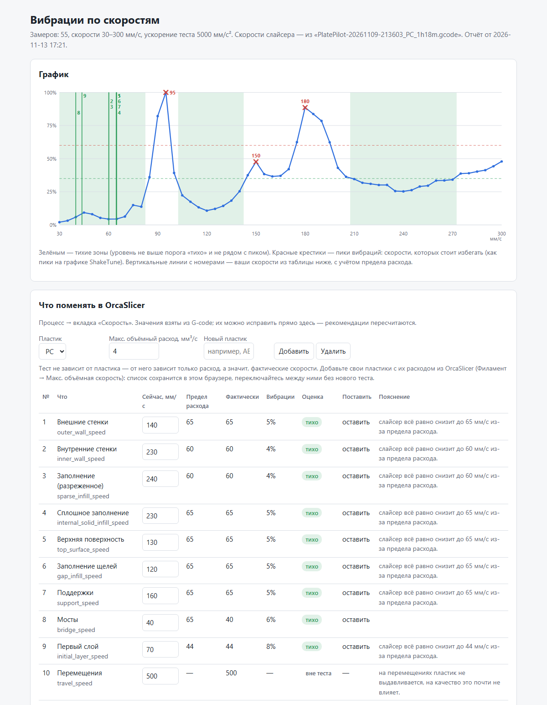

# klipper-vibr-report — на каких скоростях принтер «звенит»

Одна команда в консоли Klipper — `VIBR_TEST` — дважды гоняет голову по квадрату на скоростях от 30 до 300 мм/с, записывает вибрации акселерометром и строит отчёт: график «скорость → вибрации», пики, тихие зоны и **таблицу по скоростям вашего профиля OrcaSlicer — что сейчас, тихо или резонанс, что поставить**. Отчёт — одна HTML-страница, скачивается из Fluidd/Mainsail и открывается в любом браузере без интернета.

- Сделано и проверено на **QIDI Q1 Pro со стоковой прошивкой** (Klipper QIDI на Python 2.7). Работает и на обычном Klipper.
- **ShakeTune не нужен** и не мешает: свои имена макросов и файлов. Движения головы — как у `VIBRATIONS_CALIBRATION` из ShakeTune 2.6.1.
- `printer.cfg` установщик не меняет: одну строку `[include vibr_test.cfg]` вы добавляете сами.



## Установка на стоковый QIDI Q1 Pro (одна команда)

По SSH (пользователь `mks`):

```bash
curl -fsSL https://raw.githubusercontent.com/GNUGiminot/klipper-vibr-report/main/install.sh | bash
```

Установщик проверит, что есть акселерометр, расширение `gcode_shell_command` и Python с numpy, скачает файлы в `~/klipper-vibr-report` и положит ссылку `vibr_test.cfg` в папку конфигурации. Потом один раз руками:

1. Fluidd/Mainsail → конфигурация → `printer.cfg` → рядом с другими `[include …]` добавить строку
   ```
   [include vibr_test.cfg]
   ```
2. «Сохранить и перезапустить».

## Запуск

Стол пустой, принтер не печатает. В консоли Fluidd/Mainsail:

```
VIBR_TEST
```

Оси захоумятся сами. Тест делает 2 прохода и занимает 8–10 минут (один проход — 4–5 минут).

Та же команда со всеми параметрами — скопируйте и меняйте нужные значения:

```
VIBR_TEST PASSES=2 MIN_SPEED=30 MAX_SPEED=300 SPEED_INCREMENT=5 ACCEL=5000 SIZE=80 Z_HEIGHT=20 TRAVEL_SPEED=300
```

Что они значат (все необязательные, не указанные берутся по умолчанию):

| Параметр | По умолчанию | Что это |
|---|---|---|
| `PASSES` | 2 | сколько раз пройти весь диапазон; отчёт усредняет проходы. `1` — быстрая проверка |
| `MIN_SPEED` / `MAX_SPEED` | 30 / 300 | диапазон скоростей, мм/с |
| `SPEED_INCREMENT` | 5 | шаг, мм/с (3 — точнее, но дольше) |
| `ACCEL` | 5000 | ускорение на ходах теста (не выше `max_accel` принтера) |
| `SIZE` | 80 | сторона квадрата, мм |
| `Z_HEIGHT` | 20 | высота головы, мм |
| `TRAVEL_SPEED` | 300 | холостые перемещения, мм/с |
| `CHIP` | — | имя акселерометра, если их несколько |

Пример: `VIBR_TEST MAX_SPEED=250 SPEED_INCREMENT=3`, быстрый одиночный проход — `VIBR_TEST PASSES=1`.

## Результат

Папка конфигурации → `vibr_report_results/` (хранятся 5 последних прогонов):

| Файл | Что внутри |
|---|---|
| `vibr_report_<дата>.html` | график, пики, тихие зоны, таблица «что поменять в OrcaSlicer», все замеры |
| `vibr_recommendations_<дата>.csv` | ваши скорости, предел расхода, уровень вибраций, оценка, что поставить |
| `vibr_summary_<дата>.csv` | по каждой скорости теста: уровень, оценка, пик, оси X/Y/Z, главная частота |
| `vibr_data_<дата>.tar.gz` | сами замеры — для пересборки отчёта |

CSV — с разделителем `;` и десятичной запятой (русский Excel открывает двойным щелчком).

**Пластик.** Тест от пластика не зависит — голова ходит без подачи. От пластика зависит только максимальный объёмный расход, а значит, с какой скоростью слайсер реально напечатает линию. Скорости и расход отчёт берёт из самого свежего G-code. В отчёте есть список пластиков: добавьте свои (например, PC 4, ABS 17 мм³/с) — он сохранится в браузере, и переключение пересчитывает таблицу без нового теста.

**Как читать.** Уровень — энергия вибраций в процентах от самой «шумной» скорости теста. «Тихо» — не выше 35 % и не рядом с пиком (±1 шаг теста). Пики ищутся как в ShakeTune: и главный резонанс, и небольшие местные бугры. «Фактически» — скорость с учётом предела расхода. «Поставить» — ближайшая тихая скорость не выше предела расхода, с запасом от края резонанса.

**Проходы.** Высота пиков от прогона к прогону заметно меняется (на проверочном принтере пик 95 мм/с был 39 % в одном прогоне и 100 % в другом), а места пиков — нет. Поэтому тест по умолчанию делает 2 прохода: каждый проход приводится к своему максимуму, уровни усредняются, и пики, тихие зоны и рекомендации считаются по среднему. На графике отдельные проходы видны серыми пунктирами — если они сильно расходятся, повторите тест. После того как подтянули ремни или что-то закрепили, тест нужно повторить в любом случае.

## Установка вручную (не сток, другой Klipper — с нуля)

Нужно:

- **Акселерометр** в конфиге (`[adxl345]` или другой) и рабочий: `ACCELEROMETER_QUERY` в консоли отвечает без ошибки.
- **Расширение `gcode_shell_command`** — файл `~/klipper/klippy/extras/gcode_shell_command.py`. На стоковом QIDI есть; на обычном Klipper ставится через KIAUH → Advanced → G-Code Shell Command.
- **Python с numpy.** На стоковом QIDI есть системный `python3` с numpy. На обычном Klipper numpy ставят в окружение Klipper для калибровки шейперов: `~/klippy-env/bin/pip install numpy`.

Затем:

```bash
cd ~
git clone https://github.com/GNUGiminot/klipper-vibr-report.git
chmod +x ~/klipper-vibr-report/*.sh
ln -s ~/klipper-vibr-report/vibr_test.cfg ~/printer_data/config/vibr_test.cfg   # на стоковом QIDI: ~/klipper_config/
```

В `printer.cfg` — `[include vibr_test.cfg]`, сохранить и перезапустить. Если клонировали не в `~/klipper-vibr-report`, поправьте путь в строке `command:` в `vibr_test.cfg`.

Вместо этих команд можно запустить `bash ~/klipper-vibr-report/install.sh` — он делает то же самое и проверяет требования.

## Если у вас уже стоит ShakeTune 2.x

Конфликтов нет: другие имена макросов (`VIBR_TEST`, `_VIBR_RUN`), команды (`vibr_report`) и файлов замеров (`*-vibr_sp*.csv`). Файлы ShakeTune не трогаются.

Отчёт можно построить и из замеров ShakeTune. На стоковом QIDI Q1 Pro его `VIBRATIONS_CALIBRATION` нужно запускать так (датчик в Klipper QIDI называется `default`, а без хоминга макрос не стартует):

```
G28
VIBRATIONS_CALIBRATION DIRECTION=XY MAX_SPEED=300 SPEED_INCREMENT=5 ACCEL_CHIP=default
```

Картинку ShakeTune он не построит («No CSV files found»: файлы сохранены как `adxl345-sp*.csv`, а ищутся `default-sp*.csv`) — постройте её вручную и сразу отчёт из тех же замеров (по SSH):

```bash
~/klipper-vibr-report/vibr_report.sh --input /tmp
~/klipper_config/K-ShakeTune/scripts/shaketune.sh --type vibrations --axis_name XY --accel 5000 --chip_name adxl345 --keep_csv
```

Отчёт — первым: ShakeTune после картинки упаковывает CSV в архив и удаляет их из `/tmp`. Из архива отчёт тоже собирается: `--input ~/klipper_config/K-ShakeTune_results/vibrations/vibrations_<дата>_XY.tar.gz`.

Подойдёт только ShakeTune 2.x (с файлами CSV). ShakeTune 3.x и новее хранит замеры в другом формате.

## Параметры скрипта отчёта

`~/klipper-vibr-report/vibr_report.sh [параметры]` — по SSH; без параметров берёт свежие замеры `VIBR_TEST` из `/tmp`, а если их нет — последний архив.

| Параметр | Что |
|---|---|
| `--input <папка/CSV/архив>` | замеры не из `/tmp` (в том числе ShakeTune) |
| `--gcode <файл или папка>` | скорости из конкретного G-code |
| `--maxvol 12` | макс. объёмный расход вместо значения из G-code |
| `--quiet 35 --peak 60` | пороги «тихо» и «резонанс», % от максимума |
| `--out <папка>` | куда сохранить отчёт |

## Обновление и удаление

- Обновить: снова запустить команду установки (или `bash ~/klipper-vibr-report/install.sh`) и перезапустить Klipper.
- Обновления из Fluidd/Mainsail: добавить в `moonraker.conf` секцию из `moonraker_update.conf`.
- Удалить: убрать `[include vibr_test.cfg]` из `printer.cfg`, сохранить, затем `bash ~/klipper-vibr-report/uninstall.sh`. Результаты остаются.

## Особенности стокового QIDI Q1 Pro (учтены)

- Klipper QIDI работает на Python 2.7 и принимает вывод скриптов только латиницей — поэтому сообщения в консоли на английском, а отчёт на русском.
- Нет `MINIMUM_CRUISE_RATIO` — макрос сам использует `ACCEL_TO_DECEL`.
- Хоминг QIDI (`homing_override`) ставит `M204 S10000`; после теста восстанавливаются значения, которые были после хоминга.

## Проверено

QIDI Q1 Pro, прошивка 4.4.20, 13.11.2026: установка, `VIBR_TEST` (4,5 мин), отчёт из консоли Klipper; отчёт из замеров ShakeTune 2.6.1. Не проверено на обычном Klipper и с G-code из QIDI Studio / Bambu Studio (ключи скоростей у них, скорее всего, те же, что в OrcaSlicer).

## Лицензия

GPL-3.0. Движения теста перенесены из `VIBRATIONS_CALIBRATION` проекта [Klippain ShakeTune](https://github.com/Frix-x/klippain-shaketune) (Frix-x, GPL-3.0).

Автор: Giminot — https://t.me/Giminot

---

# English

## klipper-vibr-report — at which speeds does your printer ring?

One console command — `VIBR_TEST` — moves the toolhead twice around a square at 30–300 mm/s, records vibrations with the accelerometer and builds a report: a "speed → vibrations" chart, vibration peaks, quiet speed zones and **a table for the speeds of your OrcaSlicer profile — current value, quiet or resonance, what to set**. The report is a single HTML page: download it from Fluidd/Mainsail and open it in any browser, no internet needed.

- Made and tested on **stock QIDI Q1 Pro** (QIDI Klipper on Python 2.7). Works on mainline Klipper too.
- **ShakeTune is not required** and does not conflict (own macro and file names). The motion pattern is the same as ShakeTune 2.6.1 `VIBRATIONS_CALIBRATION`.
- The installer does not touch `printer.cfg`: you add one `[include vibr_test.cfg]` line yourself.

### Install on a stock QIDI Q1 Pro (one command)

Over SSH (user `mks`):

```bash
curl -fsSL https://raw.githubusercontent.com/GNUGiminot/klipper-vibr-report/main/install.sh | bash
```

It checks the accelerometer, the `gcode_shell_command` extension and Python with numpy, clones the files to `~/klipper-vibr-report` and links `vibr_test.cfg` into your config folder. Then once:

1. Fluidd/Mainsail → configuration → `printer.cfg` → next to the other `[include …]` lines add `[include vibr_test.cfg]`.
2. Save & restart.

### Run

Empty bed, not printing. In the Fluidd/Mainsail console:

```
VIBR_TEST
```

The printer homes itself. The test makes 2 passes and takes 8–10 minutes (one pass: 4–5 minutes). The same command with every parameter spelled out — copy it and change what you need:

```
VIBR_TEST PASSES=2 MIN_SPEED=30 MAX_SPEED=300 SPEED_INCREMENT=5 ACCEL=5000 SIZE=80 Z_HEIGHT=20 TRAVEL_SPEED=300
```

| Parameter | Default | Meaning |
|---|---|---|
| `PASSES` | 2 | full sweeps; the report averages them. `1` = quick check |
| `MIN_SPEED` / `MAX_SPEED` | 30 / 300 | speed range, mm/s |
| `SPEED_INCREMENT` | 5 | step, mm/s (3 is finer but slower) |
| `ACCEL` | 5000 | acceleration of the test moves (capped by the printer `max_accel`) |
| `SIZE` | 80 | square side, mm |
| `Z_HEIGHT` | 20 | toolhead height, mm |
| `TRAVEL_SPEED` | 300 | travel moves, mm/s |
| `CHIP` | — | accelerometer name if you have several |

### Results

Config folder → `vibr_report_results/` (last 5 runs are kept): `vibr_report_<date>.html` (chart, peaks, quiet zones, slicer advice), `vibr_recommendations_<date>.csv`, `vibr_summary_<date>.csv`, `vibr_data_<date>.tar.gz` (raw measurements). The report UI and CSV files are in Russian; console messages are in English.

**Filament.** The test does not depend on the filament — no extrusion. The filament only sets the max volumetric flow, i.e. how fast the slicer really prints a line. Speeds and flow are read from the latest G-code. The report has a filament list: add yours (e.g. PC 4, ABS 17 mm³/s), it is saved in the browser and switching re-calculates the table without a new test.

**How to read.** Level = vibration energy in % of the noisiest test speed. "Quiet" = ≤ 35 % and not next to a peak (±1 test step). Peaks are found like in ShakeTune: the main resonance and small local bumps. "Actual" = speed after the flow limit. "Set" = nearest quiet speed below the flow limit, away from the edge of a resonance. Peak heights vary between runs, their positions do not, so the test makes 2 passes by default: each pass is normalised to its own maximum and the levels are averaged; peaks, quiet zones and advice use the average. Individual passes are shown as grey dashed lines — if they disagree a lot, repeat the test.

### Manual install (non-stock / other Klipper)

Requirements: a working accelerometer (`ACCELEROMETER_QUERY` answers), the `gcode_shell_command` extension (KIAUH → Advanced → G-Code Shell Command) and numpy in Klipper's Python (`~/klippy-env/bin/pip install numpy`).

```bash
cd ~
git clone https://github.com/GNUGiminot/klipper-vibr-report.git
chmod +x ~/klipper-vibr-report/*.sh
ln -s ~/klipper-vibr-report/vibr_test.cfg ~/printer_data/config/vibr_test.cfg   # stock QIDI: ~/klipper_config/
```

Add `[include vibr_test.cfg]` to `printer.cfg`, save & restart. Or just run `bash ~/klipper-vibr-report/install.sh` — it does the same and checks the requirements.

### Already have ShakeTune 2.x?

No conflicts. You can also build the report from ShakeTune measurements: `~/klipper-vibr-report/vibr_report.sh --input /tmp` right after `VIBRATIONS_CALIBRATION` (on stock QIDI run it with `ACCEL_CHIP=default` after `G28`), or `--input <ShakeTune vibrations .tar.gz>`. ShakeTune 3.x+ stores data differently and is not supported.

### Update / remove

Update: run the install command again and restart Klipper (or add `moonraker_update.conf` to `moonraker.conf`). Remove: delete the include line from `printer.cfg`, save, then `bash ~/klipper-vibr-report/uninstall.sh` (results are kept).

### License

GPL-3.0. Test motion ported from [Klippain ShakeTune](https://github.com/Frix-x/klippain-shaketune) `VIBRATIONS_CALIBRATION` (Frix-x, GPL-3.0). Author: Giminot — https://t.me/Giminot
